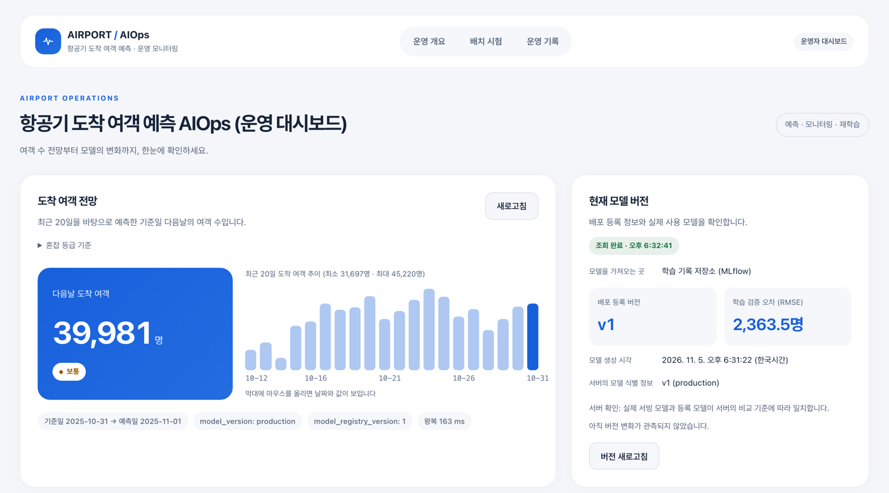
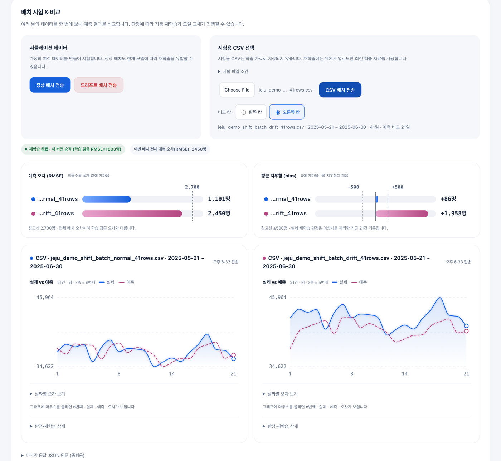
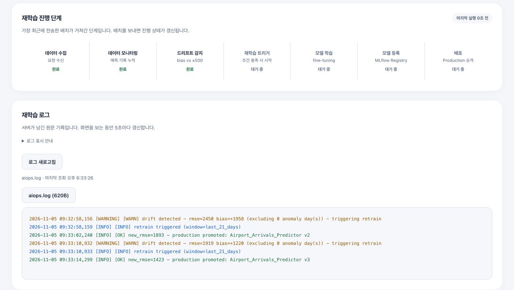
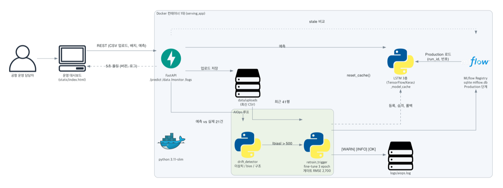
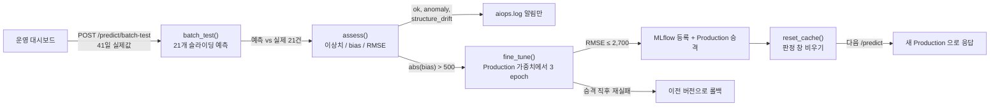
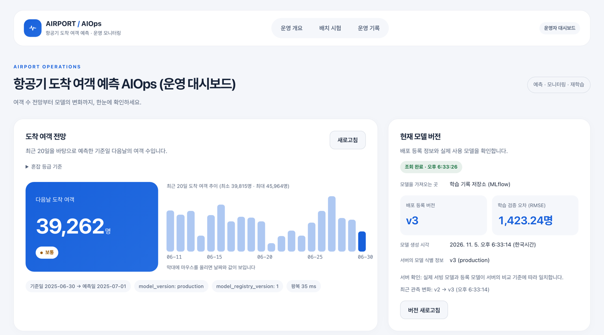
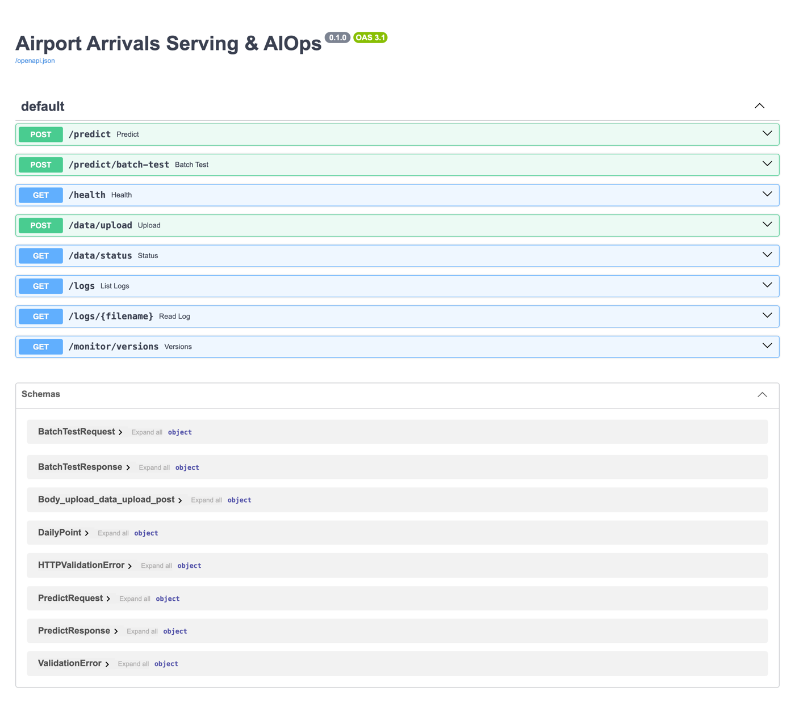
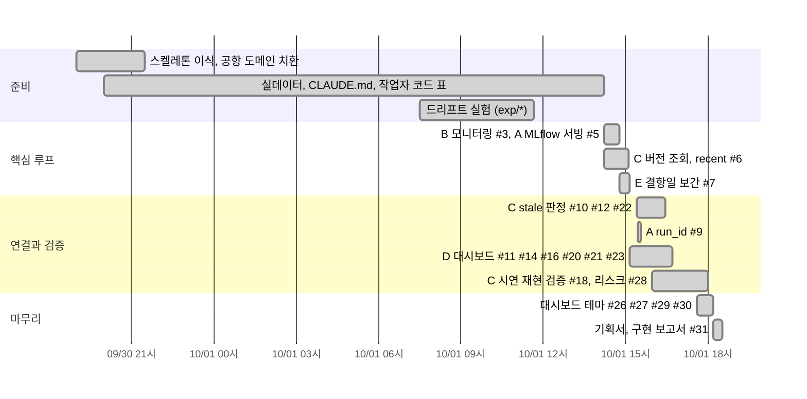

# 예측 모델 서비스 및 운영 관리

제주공항의 **다음날 도착 여객 수**를 LSTM으로 예측해 FastAPI로 서빙하고, 예측이 틀어지기 시작하면 사람 없이 감지, 재학습, 재배포까지 이어지게 만든 서비스입니다.
<br>
<br>
공항 운영 담당자가 전날 미리 인력, 셔틀, 카운터를 조정할 수 있도록 예측값과 혼잡 등급을 보여주고, 모델이 조용히 낡아 가는 상황(드리프트)을 운영 대시보드 한 화면에서 확인할 수 있게 했습니다.
<br>
<br>
설계하면서 고른 것과 포기한 것은 [⚖️ 트레이드오프](#-트레이드오프)와 [💭 이유 있는 코드](#-이유-있는-코드)에 정리했습니다.

| 운영 대시보드 (v1 서빙 중) | 드리프트 감지 후 자동 재학습 | 재학습 진행 단계와 로그 |
|:-:|:-:|:-:|
|  |  |  |
| 예측 카드와 현재 Production 버전 | 같은 41일, 뒤 21일만 +15% → bias +1,958 → v2 승격 | `[WARN]` → `[INFO]` → `[OK]` 가 4초 안에 |

> 위 화면은 모두 2026-11-05 `main`(`c1f65aa`) 을 컨테이너로 띄워 실제로 시연 순서를 돌리며 찍었습니다 (포트 8600).

<br>

## 📚 목차
- [💻 실행 방법](#-실행-방법)
- [📚 구현 스펙](#-구현-스펙)
- [🎯 문제 정의](#-문제-정의)
- [🏗️ 아키텍처](#-아키텍처)
- [📱 주요 기능](#-주요-기능)
- [🧨 트러블슈팅](#-트러블슈팅)
- [💭 이유 있는 코드](#-이유-있는-코드)
- [⚖️ 트레이드오프](#-트레이드오프)
- [📅 일정 관리](#-일정-관리)
- [👥 팀 구성과 역할](#-팀-구성과-역할)
- [🧠 AI 활용법](#-ai-활용법)

### 📖 Wiki
[Home](docs/wiki/Home.md) | [Architecture](docs/wiki/Architecture.md) | [Tradeoffs](docs/wiki/Tradeoffs.md) | [Troubleshooting](docs/wiki/Troubleshooting.md) | [Schedule](docs/wiki/Schedule.md) | [Evaluation](docs/wiki/Evaluation.md) | [API](docs/wiki/API.md)

<br>
<br>

## 💻 실행 방법

컨테이너 한 대면 됩니다. 이미지 빌드 중에 학습 데이터 시드, baseline 학습, MLflow 등록과 Production 승격까지 끝나 있어서 띄우자마자 예측이 됩니다.

```bash
git clone https://github.com/YooGyeongMo/skala-model-serving.git
cd skala-model-serving

# 1) 컨테이너로 실행 (권장)
docker compose -f serving_app/docker-compose.yml up --build
#    → http://localhost:8000/      운영 대시보드
#    → http://localhost:8000/docs  Swagger
```

로컬 Python(3.11 또는 3.12)으로 단계별로 돌릴 수도 있습니다.

```bash
python3.12 -m venv .venv && source .venv/bin/activate
pip install -r requirements.txt

uvicorn serving_app.main:app --port 8000          # 대시보드에서 data/jeju_airport_arrivals.csv 업로드
python scripts/train_baseline_v1.py               # Day1: 로컬 baseline + scaler.pkl
python serving_app/train_and_register.py          # Day2: MLflow(sqlite) 기록, 게이트 통과 시 Production
MODEL_SOURCE=mlflow uvicorn serving_app.main:app --port 8000
```

드리프트 시연은 대시보드의 "시험용 CSV 선택"에서 아래 순서로 보내면 됩니다.

```
1. data/jeju_demo_shift_batch_normal_41rows.csv     정상 배치  → ok
2. (학습 데이터 카드) data/jeju_demo_shift_upload_until_20250630.csv 업로드
3. data/jeju_demo_shift_batch_drift_41rows.csv      드리프트 배치 → 재학습 → v2
4. 같은 파일 재전송                                   → v3
5. 같은 파일 재전송                                   → ok (스스로 멈춤)
```

외부 API 키가 없어서 클론 후 바로 실행됩니다. 원본 팀 저장소는 [wonn2k/skala-model-serving](https://github.com/wonn2k/skala-model-serving) 입니다.

[⬆️  목차로](#-목차)

<br>
<br>

## 📚 구현 스펙

| 항목 | 내용 |
|---|---|
| Language | Python 3.11 (컨테이너), 3.11 또는 3.12 (로컬) |
| 서빙 | FastAPI 0.141, Uvicorn, Pydantic 2 (입력 스키마 검증, 위반 시 422) |
| 모델 | TensorFlow 2.21 Keras, LSTM 3층 (입력 20일 × 도착/출발 2피처 → 다음날 도착 여객) |
| MLOps | MLflow 3.16 (sqlite 트래킹, Model Registry Production 단계, 게이트 RMSE ≤ 2,700명) |
| AIOps | 드리프트 3종 판정 (이상치 / 수준 / 구조), warm start fine-tuning, 자동 승격과 롤백, `logs/aiops.log` |
| 인프라 | Docker 단일 컨테이너 (`python:3.11-slim`, 이미지 3.26GB), docker compose |
| 프론트엔드 | 라이브러리 없는 정적 HTML/JS 대시보드 1페이지 (차트는 인라인 SVG) |
| 데이터 | 한국공항공사 제주공항 일별 여객 2023-01-01 ~ 2025-10-31 (1,035일) |
| 테스트 | `unittest` (`tests/test_serving_identity.py`: 서빙 모델 식별, 판정 창 회귀) |
| 협업 | 작업자 코드(A~E)별 파일 소유, `feat/*` 브랜치 → PR → merge (PR 25개) |

[⬆️  목차로](#-목차)

<br>
<br>

## 🎯 문제 정의

모델을 한 번 학습해서 API로 여는 건 어렵지 않습니다. 어려운 건 **그 모델이 몇 달 뒤에도 맞는지 누가 보느냐** 였습니다.

실제 데이터를 보니 제주공항 도착 여객은 2025년 1분기에 전년 대비 **−12% ~ −13%** 로 몇 달 동안 내려갔다가 하반기에 회복했습니다. 반면 폭설로 하루 6,088명까지 떨어진 날은 다음날 바로 돌아왔습니다. 둘 다 "예측이 크게 틀렸다"로 보이지만 대응은 정반대여야 합니다.

```
  하루만 크게 틀림       →  이상치          →  알림만 (재학습해도 배울 게 없음)
  한쪽으로 계속 틀림     →  수준 드리프트   →  최근 데이터로 fine-tuning → 게이트 → 승격
  치우침 없이 크게 흔들림 →  구조 드리프트   →  알림만 (41일 fine-tuning 으로는 안 줄어듦)
```

그래서 "RMSE 가 임계값을 넘으면 재학습" 하나로 두지 않고, 판정을 세 갈래로 나눴습니다. 실험해 보니 RMSE 단독 판정은 재학습을 3배 더 돌리면서 오차 개선이 0 (3,039 vs 3,038) 이었기 때문입니다. ([판정 기준을 RMSE 에서 bias 로](#판정-기준을-rmse-에서-bias-로))

그다음 문제는 **재학습이 성공했다는 로그가 찍혀도 서버는 옛 모델로 답할 수 있다** 는 점이었습니다. 레지스트리에선 v2 가 Production 인데 서버 메모리엔 v1 이 남아 있는 상태입니다. 같은 seed 로 학습된 v1, v2 는 예측값까지 39,980.96 으로 같아서 응답만 봐서는 알 수가 없었습니다. 이걸 드러내는 것이 제가 맡은 `/monitor/versions` 의 역할입니다. ([레지스트리와 서빙이 다른 말을 할 때](#레지스트리와-서빙이-다른-말을-할-때))

[⬆️  목차로](#-목차)

<br>
<br>

## 🏗️ 아키텍처



> 그림 생성 스크립트: [`docs/diagrams/architecture.py`](docs/diagrams/architecture.py)

학습, 레지스트리, 서빙이 **컨테이너 한 대의 같은 파일시스템** 안에 있습니다. 학습 코드와 서빙 코드는 MLflow Registry(`models:/Airport_Arrivals_Predictor/Production`) 로만 만나고, 모니터링 상태는 프로세스 메모리(`recent_predictions`) 와 파일(`logs/aiops.log`) 에 남습니다.



| 구성 요소 | 파일 | 역할 |
|---|---|---|
| 서빙 API | `serving_app/main.py`, `routers/predict.py`, `model_loader.py` | 20일 시퀀스 → 예측. 로컬/MLflow, eager/lazy 로딩 분기, 모델 캐시 |
| 데이터 | `routers/data.py`, `data/storage.py` | CSV 업로드와 검증(최소 41행), 최신 업로드 조회, 최근 20일 `recent` |
| 학습과 배포 | `train_and_register.py`, `Dockerfile` | 100 epoch 학습, 게이트, 등록과 승격, fine-tuning |
| 모니터링 | `monitoring/drift_detector.py`, `retrain_trigger.py` | 3종 판정, 재학습 트리거, 승격, 롤백 |
| 버전 조회 | `routers/monitor.py` | 레지스트리 Production 과 서버가 실제로 든 모델을 나란히, `stale` 판정 |
| 대시보드 | `static/index.html` | 예측 카드, 배치 시험과 비교 차트, 버전 카드, 5초 로그 폴링 |

API 8개와 요청/응답 예시는 [Wiki API](docs/wiki/API.md), 배포 구조는 [Wiki Architecture](docs/wiki/Architecture.md) 에 있습니다.

[⬆️  목차로](#-목차)

<br>
<br>

## 📱 주요 기능

| 내일 도착 여객 예측과 혼잡 등급 | 재학습 두 번 뒤 v3 서빙 중 |
|:-:|:-:|
|  |  |
| 최근 20일로 다음날 39,981명, 사분위 기준 "보통". 서버 왕복 163 ms | 버전 카드가 v3, 학습 검증 RMSE 1,423.24명, 최근 관측 변화 v2 → v3 |

| 두 배치 나란히 비교 | 재학습 로그 | Swagger (API 8개) |
|:-:|:-:|:-:|
|  |  |  |
| 같은 41일인데 bias +86 (정상) vs +1,958 (드리프트) | 7단계 진행 표시와 `aiops.log` 원문, 5초마다 갱신 | `/docs` 에서 바로 호출 가능 |

이번 실행에서 실제로 나온 값입니다 (대시보드 CSV 배치, 출발 여객 실제값 포함):

| 순서 | 배치 | 판정 | 결과 |
|---|---|---|---|
| 1 | 정상 41일 | `ok` | RMSE 1,191 / bias +86 |
| 2 | 뒤 21일 +15% | `retrain_triggered` | bias +1,958 → 게이트 RMSE 1,893 → **v2** (감지부터 승격까지 4.1초) |
| 3 | 같은 파일 재전송 | `retrain_triggered` | bias +1,220 → 게이트 RMSE 1,423 → **v3** (3.4초) |
| 4 | 같은 파일 재전송 | `ok` | RMSE 1,564 / bias +475 → 재학습 없이 멈춤 |

fine-tune 3 epoch 는 치우침을 한 번에 다 지우지 않고 절반쯤 줄입니다. 그래서 승격이 두 번 일어나고, 세 번째에는 기준(±500) 안으로 들어와 스스로 멈춥니다.

[⬆️  목차로](#-목차)

<br>
<br>

## 🧨 트러블슈팅

### 1. 재학습이 성공했는데 서버는 옛 모델로 답했다 [#6](https://github.com/wonn2k/skala-model-serving/pull/6) [#10](https://github.com/wonn2k/skala-model-serving/pull/10) [#12](https://github.com/wonn2k/skala-model-serving/pull/12)

컨테이너 안에서 `train_and_register.py` 를 따로 돌려 v2 를 승격시키자, 로그엔 `[GATE PASSED] ... v2 promoted` 가 찍혔지만 `/predict` 는 계속 `model_registry_version: "1"` 이었습니다.
<br>
서버가 모델을 메모리(`_model_cache`) 에 들고 있어서 레지스트리가 바뀐 걸 모르기 때문입니다. 게다가 v1, v2 는 seed 42 + 같은 데이터라 예측값까지 39,980.96 으로 같아서, 응답만으로는 어긋남이 보이지 않았습니다.
<br>
`GET /monitor/versions` 를 만들어 "레지스트리의 Production" 과 "서버가 실제로 든 모델" 을 나란히 돌려주고, 둘이 다르면 `stale: true` 를 띄우게 했습니다.

| 단계 | production | serving | stale |
|---|---|---|---|
| 기동 직후 | v1 | v1 | false |
| 서버 밖에서 v2 승격 | v2 | v1 | **true** |
| 재기동 | v2 | v2 | false |

<details>
<summary>판정 순서 (routers/monitor.py)</summary>

```python
if production is not None:
    if serving_run_id is not None and production["run_id"] is not None:
        stale = serving_run_id != production["run_id"]   # 가장 좁은 식별자
        stale_basis = "run_id"
    elif serving_registry_version is not None:
        if str(serving_registry_version) != str(production["version"]):
            stale = True                                  # 번호가 다르면 확실히 다름
            stale_basis = "registry_version"
        # 번호가 같다고 같은 모델이라 단정하지 않는다 → null
```
</details>

<br>

---

### 2. 트래킹 서버가 죽으면 버전 조회 하나가 14분을 붙잡았다 [#10](https://github.com/wonn2k/skala-model-serving/pull/10)

응답 없는 주소(`10.255.255.1:9999`) 로 `/monitor/versions` 를 호출하자 **848.03초(14분 8초)** 뒤에야 돌아왔습니다.
<br>
MLflow 기본값이 요청 120초 + 재시도 7회이고, 이 핸들러가 `def`(sync) 라 그동안 AnyIO 스레드풀 슬롯 하나를 물고 있었습니다. 같은 풀을 쓰는 `/predict`, `/health` 까지 느려질 수 있는 구조입니다.
<br>
조회 전용이라 재시도 가치가 낮다고 보고, 모듈 로드 시점에 짧은 기본값을 심었습니다. `setdefault` 라 운영에서 환경변수로 올리면 그 값이 이깁니다.

| 설정 | 응답 시간 |
|---|---|
| MLflow 기본값 | 848.03초 |
| 재시도 1회 | 10.68초 |
| 타임아웃 5초, 재시도 없음 | **5.70초** |
| (참고) 연결 거부 | 0.54초 |

<details>
<summary>해결</summary>

```python
os.environ.setdefault("MLFLOW_HTTP_REQUEST_TIMEOUT", "5")
os.environ.setdefault("MLFLOW_HTTP_REQUEST_MAX_RETRIES", "0")
```
</details>

<br>

---

### 3. 트래킹 URI 오타가 "모델 없음" 으로 보였다 [#10](https://github.com/wonn2k/skala-model-serving/pull/10)

조회 실패를 처음엔 모두 `production: null` 로 돌려줬더니, "아직 등록된 모델 없음 / URI 오타 / 트래킹 서버 다운 / mlflow 미설치" 네 상황이 똑같이 보였습니다. 첫 번째만 정상이고 나머지는 장애인데, 이대로면 멀쩡한 모델을 롤백하는 판단을 할 수 있습니다.
<br>
더 까다로운 건 sqlite URI 오타였습니다. MLflow 가 그 이름으로 **빈 DB 를 새로 만들고 조회는 "성공"** 해서 예외조차 나지 않았습니다. 실제로 이렇게 생긴 876KB 짜리 `does_not_exist_typo.db` 가 `git add -A` 에 쓸려 main 까지 들어갔습니다.
<br>
예외로 잡히는 경우는 `registry_error` 에 타입과 메시지를 담고, 예외가 안 나는 오타는 어느 저장소를 봤는지 `tracking_uri` 를 함께 내려 사람이 보고 판단하게 했습니다. 바이너리는 지우고 `.gitignore` 에 `*.db` 추가를 요청했습니다.

<br>

---

### 4. 배치 두 개가 겹치자 같은 데이터로 두 번 승격됐다 [#14](https://github.com/wonn2k/skala-model-serving/pull/14)

대시보드에서 배치 버튼이 연달아 눌려 `POST /predict/batch-test` 두 건이 1.4초 간격으로 겹쳤고, 같은 v5 에서 같은 데이터로 각각 fine-tune 해 v6, v7 이 연속 승격됐습니다 (둘 다 `new_rmse=2233`).
<br>
`check_and_trigger()` 에 동시 실행 방지가 없었기 때문입니다. 화면에서는 전송 중 버튼 비활성화와 재진입 방지로 막았고 (D2 담당), 이후 3건을 순서대로 보냈을 때 승격 3회가 겹치지 않는 것을 확인했습니다. 서버 쪽 잠금은 남은 과제로 기록했습니다.

```
15:53:27,297 [OK] new_rmse=2233 - production promoted: v6
15:53:28,672 [OK] new_rmse=2233 - v7          ← 1.4초 뒤 같은 값으로 또 승격
```

<br>

---

### 5. "정상 배치" 버튼이 Production 모델을 바꿔 놓았다 [#28](https://github.com/wonn2k/skala-model-serving/pull/28)

"CSV 배치를 계속 누르면 값이 달라진다" 는 보고를 따라가 보니, 대시보드의 랜덤 "정상 배치" 는 시드 없는 `Math.random()` 으로 매번 새 입력을 만들고 있었습니다. 더 큰 문제는 이 난수 배치가 우연히 bias 500 을 넘으면 **진짜로 재학습하고 승격까지 한다** 는 점이었습니다.

| 클릭 | 화면 RMSE | 서버 판정 |
|---|---|---|
| 1 | 506명 | 정상 |
| 2 | 449명 | 정상 |
| 3 | 740명 | **재학습 완료, 새 버전 승격** |
| 4 | 521명 | 정상 |

그 뒤로는 고정 CSV 의 결과까지 영구히 바뀝니다 (승격 전 bias +259.04 → 후 −130.23). 승격 전후 각각은 반복해도 소수점까지 같아서 원인이 모델 교체 하나뿐임을 확인했습니다. 시연은 고정 CSV 로만 하도록 문서에 기록했습니다.

<br>

---

### 6. 결항일 때문에 모델이 20일 이동평균이 됐다 [#7](https://github.com/wonn2k/skala-model-serving/pull/7)

폭설 결항일(최저 1,042명) 이 섞인 채 학습하자 스케일러 정상 범위가 0.63 ~ 0.96 으로 눌리고, 결항일 하나의 제곱오차가 평상시 수백 일보다 커서 모델이 평평한 이동평균이 됐습니다 (예측 표준편차 445 vs 실제 2,444).
<br>
학습 데이터에서만 도착 25,000명 미만 18일을 양옆 평균으로 보간하고, 서빙에는 raw 가 그대로 들어오게 둔 뒤 하루 오차 10,000 초과를 이상치로 분리했습니다.

| | 평상시 RMSE | 예측 표준편차 |
|---|---|---|
| 결항일 포함 학습 | 2,415 | 445 |
| 결항일 보간 학습 | **1,807** | 1,898 |

요일, 공휴일 피처도 시도했지만 2,344 → 2,695 로 오히려 나빠져 넣지 않았습니다.

더 많은 사례는 [Wiki Troubleshooting](docs/wiki/Troubleshooting.md) 에 있습니다.

[⬆️  목차로](#-목차)

<br>
<br>

## 💭 이유 있는 코드

### 레지스트리와 서빙이 다른 말을 할 때

`/monitor/versions` 는 "모델이 몇 번인가" 를 알려주는 API 로 시작했지만, 만들면서 진짜 역할은 **"모르는 걸 모른다고 말하기"** 라고 정리했습니다.

- `stale: true` 는 확실히 어긋났을 때만 (run_id 가 다르거나, 번호가 다름)
- `stale: null` 은 판정할 근거가 없을 때 (lazy 로딩 전, run_id 없이 번호만 같음)
- `stale_basis` 로 무엇을 근거로 판정했는지 함께

처음엔 run_id 가 없을 때 번호가 같으면 `false` 를 돌려줬는데, 그건 "확인했고 문제 없다" 는 뜻이라 근거 없는 안심을 줍니다. 같은 번호가 다른 run 을 가리키게 다시 등록될 수 있기 때문입니다. 그래서 그 경우를 `null` 로 바꿨습니다. ([#22](https://github.com/wonn2k/skala-model-serving/pull/22))

또 하나, 자동 재학습 흐름에서는 `stale: true` 가 뜨지 않습니다. `retrain_trigger` 가 승격 직후 `reset_cache()` 를 불러 캐시를 비우기 때문입니다. true 가 뜨는 건 승격이 **이 서버 밖에서** 일어났을 때 (MLflow UI 수동 승격, 별도 배치, 다른 인스턴스) 이고, 운영에서 캐시가 썩는 경로가 바로 그쪽이라 이 API 가 필요하다고 판단했습니다.

<br>

---

### 판정 기준을 RMSE 에서 bias 로

RMSE 는 "얼마나 틀렸나" 이고 bias(실제 − 예측의 평균) 는 "한쪽으로 치우쳤나" 입니다. fine-tuning 으로 고칠 수 있는 건 치우침뿐이었습니다.

- 보간 모델도 변동 큰 달에는 21일 RMSE 가 2,700 을 넘는 날이 107일
- RMSE 트리거 10회 중 7회는 bias ±800 안쪽, 즉 수준 변화가 아닌 흔들림
- 그 결과 재학습 3배, 오차 개선 0 (3,039 vs 3,038)

그래서 `|bias| > 500` 일 때만 재학습하고, 치우침 없이 RMSE 만 큰 경우는 구조 드리프트로 알림만 남깁니다. RMSE ≥ |bias| 가 항상 성립해서 드리프트 조건에 RMSE 항은 따로 두지 않았습니다.

<details>
<summary>assess() 의 세 갈래 (monitoring/drift_detector.py, retrain_trigger.py)</summary>

```python
anomalies = [p for p in window if abs(p["actual"] - p["predicted"]) > ANOMALY_THRESHOLD]  # 10,000
# 이상치를 뺀 나머지로
drift = abs(bias_excl) > BIAS_THRESHOLD                                                   # 500
if not drift and rmse_excl > RMSE_THRESHOLD:                                              # 2,700
    status = "structure_drift"   # 알림만, 재학습 안 함
```
</details>

<br>

---

### 승격은 "확정" 되기 전까지 되돌릴 수 있다

41행 fine-tuning 은 1분기 저점 같은 일시적 변화에 과적응할 수 있고, 게이트 검증은 5일뿐이라 400 ~ 2,742 로 흔들립니다. 그래서 승격 직후 첫 판정이 또 드리프트이고 그 재학습이 게이트를 못 넘으면, 새 버전을 Archived 로 내리고 이전 버전을 Production 으로 되돌립니다. 승격 뒤 드리프트가 아닌 윈도우가 한 번 나오면 승격을 확정합니다.

<details>
<summary>롤백 (monitoring/retrain_trigger.py)</summary>

```python
if result["promoted"]:
    model_loader.reset_cache()      # 다음 /predict 부터 새 Production
    recent_predictions.clear()      # 이전 모델의 예측으로 새 모델을 판정하지 않도록
    _last_promotion = {"prev": prev, "new": result["version"]}
elif _last_promotion:
    return _rollback(result["rmse"])  # prev → Production, new → Archived
```
</details>

[⬆️  목차로](#-목차)

<br>
<br>

## ⚖️ 트레이드오프

| 결정 | 대안 | 고른 이유 | 비용 | 다시 볼 조건 |
|---|---|---|---|---|
| 학습, MLflow(sqlite), 서빙을 **컨테이너 한 대** 에 | MLflow 서버 + 서빙 컨테이너 분리 | 모델과 아티팩트를 네트워크로 찾아갈 일이 없고, 어느 PC 에서나 `up --build` 한 줄로 재현 | 컨테이너를 새로 만들면 재학습 이력이 사라짐, 서버 여러 대 불가 | 인스턴스가 2대 이상이 될 때 |
| 이미지 **빌드 시점에 학습** | 기동 후 학습 스크립트 실행 | 띄우자마자 v1 이 Production, 초기화 순서가 없음 | 이미지 3.26GB, 빌드에 학습 32.6초 포함 | 데이터가 자주 바뀌어 이미지를 매번 다시 구워야 할 때 |
| 재학습은 **warm start 3 epoch** | 처음부터 재학습, 10 epoch | 21일로는 scratch 학습이 불안정. 3/10/30 epoch 의 게이트 실패 3/8/16회 | 한 번에 치우침을 절반만 줄여 승격이 두 번 필요 | 검증 구간을 늘릴 수 있을 때 |
| 드리프트는 **bias**, RMSE 는 구조 알림 | RMSE > 2,700 이면 재학습 | RMSE 트리거는 재학습 3배에 개선 0 | 변동 폭만 커진 변화는 자동으로 못 고침 | 피처나 모델 구조를 바꿀 수 있을 때 |
| `stale` 판정은 **run_id 우선, 모르면 null** | 번호만 비교, 같으면 false | 같은 번호의 재등록까지 잡고, "모름" 과 "정상" 을 구분 | 클라이언트가 null 을 따로 처리해야 함 | 레지스트리를 별칭(alias) 방식으로 옮길 때 |
| 버전 조회는 **타임아웃 5초, 재시도 없음** | MLflow 기본값 | sync 핸들러가 스레드풀을 오래 물지 않게 | 일시 장애 때 한 번에 실패를 보여줌 | 조회가 다른 기능의 선행 조건이 될 때 |

결정마다의 상황, 근거 수치는 [Wiki Tradeoffs](docs/wiki/Tradeoffs.md) 에 15건으로 정리했습니다.

[⬆️  목차로](#-목차)

<br>
<br>

## 📅 일정 관리

이틀 동안 PR 25개로 진행했습니다. Day1 저녁에 도메인 치환과 협업 규칙을 먼저 깔고, Day2 오후에 담당별 PR 을 병렬로 올렸습니다. (시각은 KST)



- 같은 파일을 두 사람이 동시에 고치지 않도록 **작업자 코드(A~E) 별로 담당 파일을 나눴습니다.** 남의 영역은 고치지 않고 `docs/code_current.md` 자기 섹션의 "다른 영역에 요청" 에 적습니다.
- 코드를 바꾸면 같은 PR 에서 `docs/code_current.md` 에 실행한 수치를 남기는 것을 완료 조건으로 뒀습니다. 이 기록이 그대로 [구현 보고서](docs/IMPLEMENTATION_REPORT.md) 와 기획서의 원자료가 됐습니다.

자세한 타임라인과 브랜치 전략은 [Wiki Schedule](docs/wiki/Schedule.md).

[⬆️  목차로](#-목차)

<br>
<br>

## 👥 팀 구성과 역할

5개 역할, 5명입니다. 커밋과 PR 작성자 기준으로 정리했습니다.

| 코드 | 역할 | GitHub | 주요 PR |
|---|---|---|---|
| A | 서빙 API (MLflow 로더, 캐시, run_id) | [dh610](https://github.com/dh610) | #5, #9 |
| B, E | 모니터링과 AIOps, 데이터와 상수, 통합, 기획서 | [wonn2k](https://github.com/wonn2k) | #1, #2, #3, #7, #17, #24, #31 |
| **C** | **학습, 배포, 버전 조회 (본인)** | [**YooGyeongMo**](https://github.com/YooGyeongMo) | **#6, #10, #12, #18, #22, #28** |
| D1 | 대시보드 예측 카드, 비교 차트 | [youjin09222](https://github.com/youjin09222) | #11, #23 |
| D2 | 대시보드 배치, 버전, 로그, 테마 | [1nyeonart](https://github.com/1nyeonart) | #14, #16, #20, #21, #26, #27, #29, #30 |

### 제가 한 일 (C, 유경모)

- **`GET /monitor/versions` 신설** ([#6](https://github.com/wonn2k/skala-model-serving/pull/6)): 레지스트리 Production 과 서빙 모델을 나란히 반환
- **`stale` 판정 실동작** ([#10](https://github.com/wonn2k/skala-model-serving/pull/10), [#12](https://github.com/wonn2k/skala-model-serving/pull/12), [#22](https://github.com/wonn2k/skala-model-serving/pull/22)): A 에게 `run_id` 보관을 요청해 연결, run_id 우선 판정, 모르면 null. 컨테이너에서 false → true → false 3단계 재현
- **장애 구분과 타임아웃** ([#10](https://github.com/wonn2k/skala-model-serving/pull/10)): `registry_error`, `tracking_uri`, MLflow 타임아웃 848초 → 5.7초. 실수로 들어간 876KB sqlite 바이너리 제거
- **`/data/status` 의 `recent`** ([#6](https://github.com/wonn2k/skala-model-serving/pull/6)): 최근 20일을 정수로 내려 대시보드가 변환 없이 `/predict` 에 넘기게 함
- **fine-tune epoch 10 → 3, compose 환경변수 통로** ([#6](https://github.com/wonn2k/skala-model-serving/pull/6), [#10](https://github.com/wonn2k/skala-model-serving/pull/10)): A 의 MLflow 로더가 들어오기 전에도 `MODEL_SOURCE=local` 로 컨테이너를 띄울 수 있게
- **Docker 재현과 시연 검증** ([#18](https://github.com/wonn2k/skala-model-serving/pull/18)): `--no-cache` 빌드 계측(이미지 3.26GB), E 의 수준 이동 시연을 main 컨테이너에서 소수점까지 재현, 드리프트 버튼이 bias 를 못 만드는 원인 분석과 계단식 생성기 10 seed 실측 (랜덤워크 0/10 vs 계단식 10/10)
- **시연 리스크 보고** ([#28](https://github.com/wonn2k/skala-model-serving/pull/28), 열림): 난수 배치가 Production 을 교체하는 문제

[⬆️  목차로](#-목차)

<br>
<br>

## 🧠 AI 활용법

팀 전체가 Claude Code 를 쓰는 전제로 저장소를 설계했습니다.

- **`CLAUDE.md` 를 하네스로**: 폴더 구조, 바꾸면 안 되는 것(모델 구조, 피처), 상수 표, 작업자 코드 표를 넣어 두고 "나 C야" 라고 하면 담당 파일과 섹션만 고치게 했습니다. 다섯 명이 각자 AI 를 써도 서로의 파일을 건드리지 않게 하는 장치였습니다.
- **실행한 값만 기록**: `docs/code_current.md` 에 "실행하지 않은 값은 미측정으로 둔다" 를 규칙으로 두고, 이 원자료를 프롬프트로 변환해 [구현 보고서](docs/IMPLEMENTATION_REPORT.md) 와 기획서 ④⑤⑥ 을 만들었습니다. 그래서 보고서의 수치는 전부 누군가 실제로 돌린 값입니다.
- **검증용 브랜치 분리**: 임계값이나 epoch 처럼 결과를 바꾸는 값은 AI 와 함께 실험 브랜치(`exp/*`) 에서 먼저 재 보고, 팀 합의 뒤에만 main 에 넣었습니다.

[⬆️  목차로](#-목차)

<br>

---

만든 맥락: SKALA AI 과정 "모델 서빙 및 AIOps" 조별 프로젝트 (2026). HAIC 종가 예측 실습 골격을 공항 도착 여객 도메인으로 옮겨 확장했습니다.
