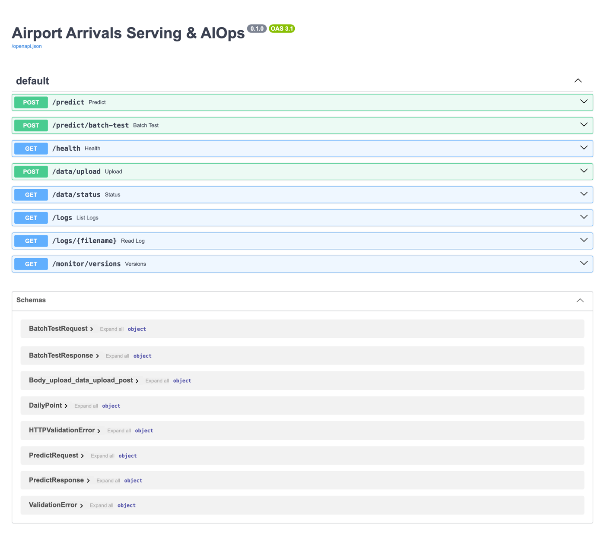

# API

[Home](Home.md) | [Architecture](Architecture.md) | [Tradeoffs](Tradeoffs.md) | [Troubleshooting](Troubleshooting.md) | [Evaluation](Evaluation.md) | [Schedule](Schedule.md)

서버 `http://localhost:8000`, Swagger `/docs`, 대시보드 `/`. 실제 호출로 확인한 전체 예시와 오류 응답은 [`docs/API_SPEC.md`](../API_SPEC.md) 에 있습니다.



| Method | URL | 용도 | 담당 |
|---|---|---|---|
| GET | `/health` | 상태, 모델 로드 여부, 로딩 모드 | A |
| POST | `/predict` | 최근 20일 → 다음날 도착 여객 | A |
| POST | `/predict/batch-test` | 41일 배치 → 슬라이딩 예측, 드리프트 판정, 자동 재학습 | B |
| POST | `/data/upload` | CSV 업로드 (`Date,Arrivals,Departures`, 41행 이상) | C |
| GET | `/data/status` | 최신 업로드 요약 + `recent` 최근 20일 | C |
| GET | `/logs` | 로그 파일 목록 | 골격 |
| GET | `/logs/{filename}` | 로그 내용 (`aiops.log`) | 골격 |
| GET | `/monitor/versions` | 레지스트리 Production vs 서빙 모델, `stale` | C |

## POST /predict

```json
{"sequence": [{"arrivals": 33285, "departures": 44836}, "...19개 더"]}
```
```json
{"predicted_arrivals": 39980.96, "model_version": "production", "model_registry_version": "1"}
```

- 정확히 20개, 값은 0 이상 정수. 위반 시 422.
- `GET /data/status` 의 `recent` 를 그대로 `sequence` 로 보낼 수 있게 맞췄습니다 (오래된 날 → 최근 날, 정수).
- MLflow Production 이 없으면 로컬 모델로 조용히 대체하지 않고 500.

## POST /predict/batch-test

```json
{"arrivals": [37934, 38881, "...", 35928], "departures": [35255, 37145, "...", 39674]}
```

`drift_check.status` 5종:

| status | 뜻 | 동작 |
|---|---|---|
| `ok` | 정상 | 없음 |
| `anomaly` | 하루 오차 > 10,000 인 날만 있음 | 알림 |
| `structure_drift` | 치우침 없이 RMSE > 2,700 | 알림 |
| `retrain_triggered` | \|bias\| > 500 | fine-tune → 게이트 통과 시 승격 (`promoted`, `version`) |
| `rolled_back` | 미확정 승격 뒤 재학습 게이트 실패 | 이전 버전 복귀 |

`drift_check.rmse`, `bias` 는 이상치 포함 값이고, 판정과 `aiops.log` 는 이상치 제외 값입니다. 화면과 로그 숫자가 다를 수 있습니다.

## GET /monitor/versions

2026-11-05 재실행 컨테이너에서 두 번 재학습한 뒤의 실제 응답:

```json
{
  "model_name": "Airport_Arrivals_Predictor",
  "model_source": "mlflow",
  "tracking_uri": null,
  "production": {"version": 3, "run_id": "591d7ed5b9cb4ac48fb9a5fae7ec17dd", "rmse": 1423.2444203840812, "created_at": 1793871194290},
  "registry_error": null,
  "serving_version": "production",
  "serving_registry_version": "3",
  "serving_run_id": "591d7ed5b9cb4ac48fb9a5fae7ec17dd",
  "stale": false,
  "stale_basis": "run_id"
}
```

| 필드 | 의미 |
|---|---|
| `production` | 레지스트리의 Production (없으면 null) |
| `serving_registry_version`, `serving_run_id` | 서버가 실제로 들고 있는 모델 (lazy 첫 요청 전이면 null) |
| `stale` | true = 어긋남 (재기동 필요), false = 일치 확인, null = 판정 불가 |
| `stale_basis` | `run_id` 또는 `registry_version`, 판정 안 했으면 null |
| `registry_error` | 조회 예외 메시지. 성공이면 null |
| `tracking_uri` | 어느 저장소를 봤는지. sqlite 오타는 예외 없이 빈 DB 를 보므로 이 값으로 구분 |
