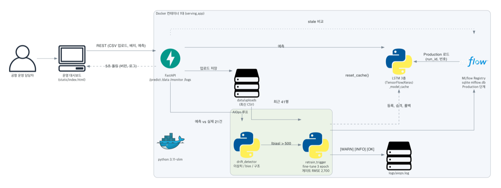
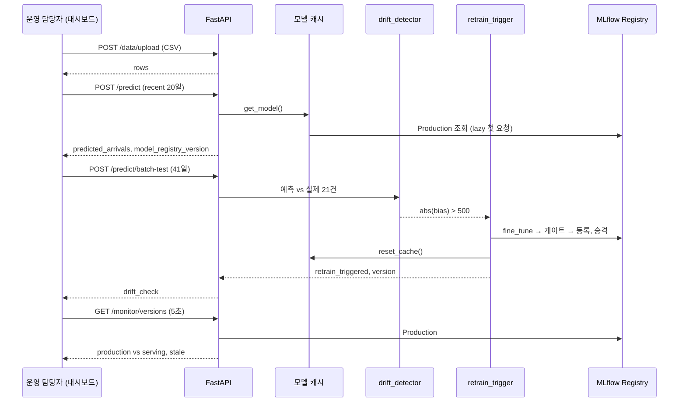

# Architecture

[Home](Home.md) | [API](API.md) | [Tradeoffs](Tradeoffs.md) | [Troubleshooting](Troubleshooting.md) | [Evaluation](Evaluation.md) | [Schedule](Schedule.md)



그림은 [`docs/diagrams/architecture.py`](../diagrams/architecture.py) 로 다시 만들 수 있습니다.

## 구성 요소

| 영역 | 파일 | 하는 일 | 담당 |
|---|---|---|---|
| 앱 진입점 | `serving_app/main.py` | 라우터 5개 등록, `aiops` 로거를 `logs/aiops.log` 에 연결, `static/` 마운트, `LOADING_MODE=eager` 면 기동 시 모델 로드 | A |
| 모델 로더 | `serving_app/model_loader.py` | `MODEL_SOURCE` 에 따라 로컬 `.keras` 또는 MLflow Production 을 로드. `LoadedModel(predict_one, version, registry_version, run_id)`. 캐시 잠금, `reset_cache()` | A |
| 예측 | `routers/predict.py` `predict()` | 20일 시퀀스 → 예측, `model_registry_version` 함께 반환 | A |
| 배치 시험 | `routers/predict.py` `batch_test()` | 41일 → 슬라이딩 예측 21개 → `recent_predictions` 누적 → `check_and_trigger()` | B |
| 판정 | `monitoring/drift_detector.py` | `assess()`: 이상치(>10,000), 수준 드리프트(\|bias\|>500), 구조 드리프트(RMSE>2,700, 치우침 없음) | B |
| 재학습 | `monitoring/retrain_trigger.py` | 드리프트면 fine-tune → 승격 시 캐시와 판정 창 비움, 미확정 승격 뒤 실패면 롤백 | B |
| 학습과 등록 | `serving_app/train_and_register.py` | 100 epoch 학습(seed 42), 게이트, 등록, Production 승격. `fine_tune()` 3 epoch, LR 1e-4 | C |
| 데이터 | `routers/data.py`, `data/storage.py` | 업로드 검증(컬럼, UTF-8, 41행 이상), 최신 업로드 경로, `recent` 20일 | C |
| 버전 조회 | `routers/monitor.py` | 레지스트리 Production vs 서빙 모델, `stale`, `stale_basis`, `registry_error`, `tracking_uri` | C |
| 컨테이너 | `serving_app/Dockerfile`, `docker-compose.yml` | 빌드 중 시드 업로드 → baseline → MLflow 학습, compose 환경변수 통로 | C |
| 대시보드 | `serving_app/static/index.html` | 예측 카드(D1), 배치 비교 차트, 버전 카드, 로그 패널(D2) | D1, D2 |
| 데이터 가공 | `scripts/prepare_jeju_data.py` | 원자료 → `Date,Arrivals,Departures`, 결항일 18일 보간 | E |

## 데이터 흐름



## 상태가 남는 곳

| 상태 | 위치 | 재시작하면 |
|---|---|---|
| 업로드 CSV | `data/uploads/` | 남음 (컨테이너 재생성 시 사라짐) |
| 모델 버전, 지표 | `mlflow.db` (sqlite), `mlruns/` | 남음 (재생성 시 빌드 시점 v1 로 돌아감) |
| 서빙 모델 | `_model_cache` (메모리) | 비워짐, 다음 요청 또는 eager 기동 시 다시 로드 |
| 판정 창 | `recent_predictions` (메모리, 최근 21건) | 비워짐 |
| 미확정 승격 기록 | `_last_promotion` (메모리) | 비워짐, **재시작 뒤에는 롤백 불가** (알려진 한계) |
| 운영 로그 | `logs/aiops.log` | 남음 |

## 배포

```
docker compose -f serving_app/docker-compose.yml up --build
```

- 베이스 `python:3.11-slim`, 빌드 8단계. `--no-cache` 빌드 기록: pip 35.5초, 빌드 중 학습과 등록 32.6초(`[GATE PASSED] rmse=2363 -> v1`), export 38.2초, 이미지 3.26GB.
- 기본값 `MODEL_SOURCE=mlflow`, `LOADING_MODE=eager`. compose 에서 `${MODEL_SOURCE:-mlflow}` 로 덮어쓸 수 있어, MLflow 로더가 없던 시점에도 `MODEL_SOURCE=local` 로 띄울 수 있었습니다.
- 포트 8000. 다른 포트가 필요하면 `docker run -p <호스트포트>:8000` 으로 띄웁니다 (README 캡처는 8600 으로 띄웠습니다).

## 로딩 모드

| 조합 | 기동 | 첫 요청 | 두 번째 요청 |
|---|---|---|---|
| local, lazy | 0.22초 | 2.04초 | 0.013초 |
| mlflow, lazy | 0.20초 | 3.51초 | 0.016초 |
| mlflow, eager | 2.15초 | 0.096초 | 0.014초 |

(A 담당 측정, macOS arm64, Python 3.12.13, 1회)

컨테이너 기본값을 eager 로 둔 이유는 [Tradeoffs](Tradeoffs.md) 의 T13 에 있습니다.
