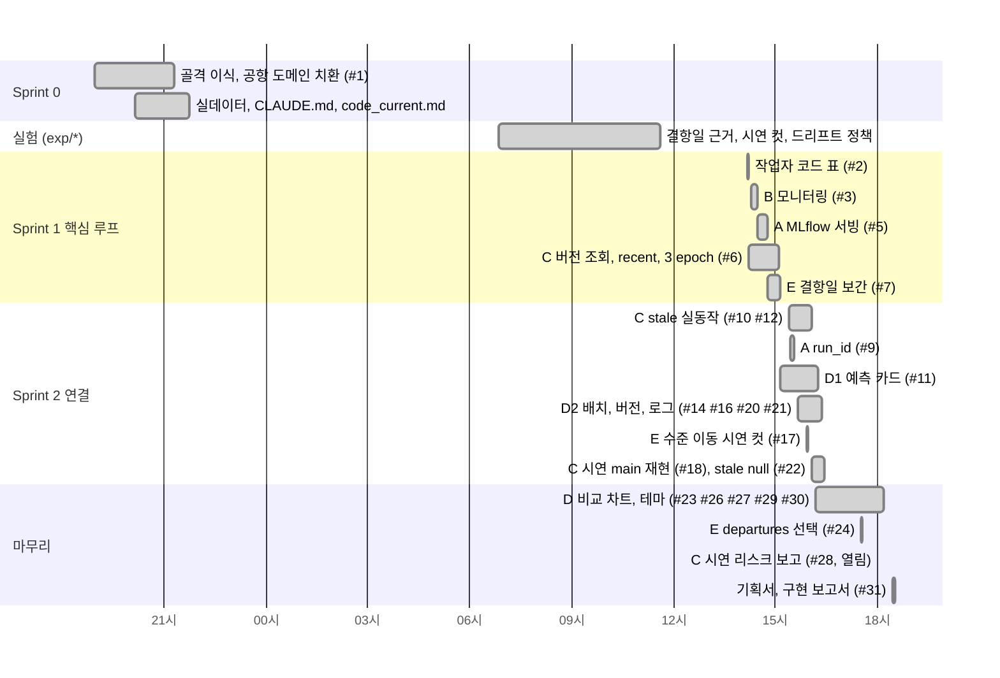

# Schedule (일정 관리)

[Home](Home.md) | [Architecture](Architecture.md) | [API](API.md) | [Tradeoffs](Tradeoffs.md) | [Troubleshooting](Troubleshooting.md) | [Evaluation](Evaluation.md)

기간: 2026-09-30 (화) 저녁 ~ 2026-10-01 (수) 18:31. 시각은 모두 KST, git log 와 PR 의 생성, 머지 시각 기준입니다.

## 타임라인

| 시각 | 사건 | 근거 |
|---|---|---|
| 09-30 18:58 | 저장소 생성 | `7684da2` |
| 09-30 19:02 ~ 21:19 | 골격 이식, 공항 도메인 치환, 팀 계획서, API 명세, 실데이터 1,035일, CLAUDE.md | `a8ffe33` ~ `d755aff`, PR #1 |
| 09-30 20:50 | Day1 baseline RMSE 2,571 기록 (게이트 통과) | `031958d` |
| 10-01 06:51 ~ 11:36 | 기획서 ①②③, 시연 컷, 드리프트 실험 (bias 판정, 롤백, 결항일 보간, 달력 피처 기각) | `exp/drift-anomaly`, `exp/clean-cancellation`, `exp/calendar-features` |
| 10-01 14:13 ~ 15:08 | 핵심 루프 PR 4개 머지 (#3 B, #5 A, #6 C, #7 E) | PR |
| 10-01 14:52 | C: 깨끗한 상태에서 전체 루프 검증 (v1 2,267 → 드리프트 bias +2,015 → v2 1,840) | `ee821df` |
| 10-01 15:24 ~ 16:27 | `stale` 판정 실동작 (#9 A, #10 #12 #22 C) | PR |
| 10-01 15:08 ~ 16:42 | 대시보드 카드, 배치, 버전, 로그, 비교 차트 | PR #11 #14 #16 #20 #21 #23 |
| 10-01 16:04 | C: E 의 수준 이동 시연을 main 컨테이너에서 소수점까지 재현 | PR #18 |
| 10-01 17:36 ~ 18:12 | 대시보드 테마 정리 | PR #26 #27 #29 #30 |
| 10-01 17:59 | C: 난수 배치의 Production 교체 리스크 보고 | PR #28 (열림) |
| 10-01 18:31 | 기획서 ④⑤⑥ 과 구현 보고서 생성 | PR #31 |

## 일을 어떻게 쪼갰나

1. **골격을 먼저 고정**: 모델 구조, 피처, SEQ_LEN, 학습 흐름은 바꾸지 않기로 정하고 (`CLAUDE.md` "반드시 지킬 것"), 바뀌는 것은 이름, 단위, 상수 3개, CSV 로 한정했습니다.
2. **파이프라인 단계 = 담당자**: 서빙(A), 모니터링(B), 학습과 배포(C), 화면(D1, D2), 데이터와 통합(E). 각 코드가 고칠 수 있는 파일 목록을 표로 박아 두었습니다.
3. **실험과 반영을 분리**: 임계값, epoch, 결항일 처리처럼 결과를 바꾸는 결정은 `exp/*` 브랜치에서 실측한 뒤 담당자 PR 로 main 에 옮겼습니다.
4. **선행 관계는 문서로 요청**: 예를 들어 C 의 `stale` 판정은 A 의 `run_id` 가 있어야 동작해서, C 는 `code_current.md` 의 "다른 영역에 요청" 에 적고, A 가 #9 로 채운 뒤 C 가 #12 로 연결했습니다.

## 브랜치와 PR 규칙

| 규칙 | 내용 |
|---|---|
| 브랜치 이름 | `feat/<코드>-<주제>`, `fix/<코드>-<주제>`, `docs/<코드>-<주제>`, 실험은 `exp/<주제>` |
| main 직접 push | 금지 (초기 세팅 제외) |
| PR 전 확인 | `python -m compileall -q data scripts serving_app`, 서버 기동, `/health` |
| 커밋 메시지 | `feat|fix|refactor|data|docs|chore: 한 줄 요약` |
| 완료 조건 | 코드 변경과 같은 PR 에서 `docs/code_current.md` 자기 섹션에 실행 명령과 실측값 기록. 실행 안 한 값은 "미측정" |
| 템플릿 | `.github/PULL_REQUEST_TEMPLATE.md`, `.github/ISSUE_TEMPLATE/{task,bug}.md` |

## 숫자로 본 진행

| 항목 | 값 |
|---|---|
| PR | 25개 (머지 24, 열림 1) |
| 이슈 | 6개 |
| main 의 non-merge 커밋 작성자 | kewonn2/wonn2k 25, G.M_YOO(YooGyeongMo) 13, youjin09222 8, 1nyeonart 5, dh610 3 |

C(YooGyeongMo) 의 커밋 13개에는 리베이스 과정에서 같은 내용이 두 번 들어간 커밋이 포함되어 있습니다. PR 기준으로는 6개 (#6, #10, #12, #18, #22 머지, #28 열림) 입니다.
